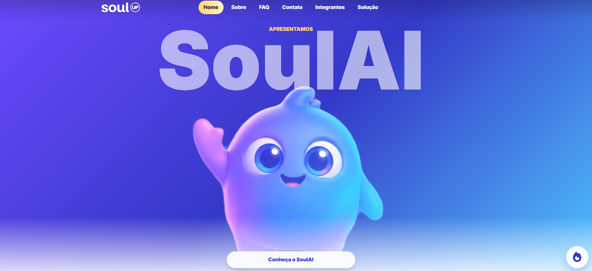
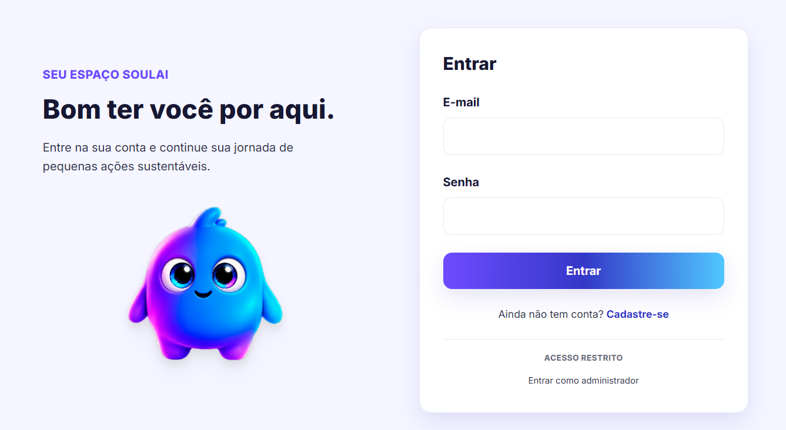
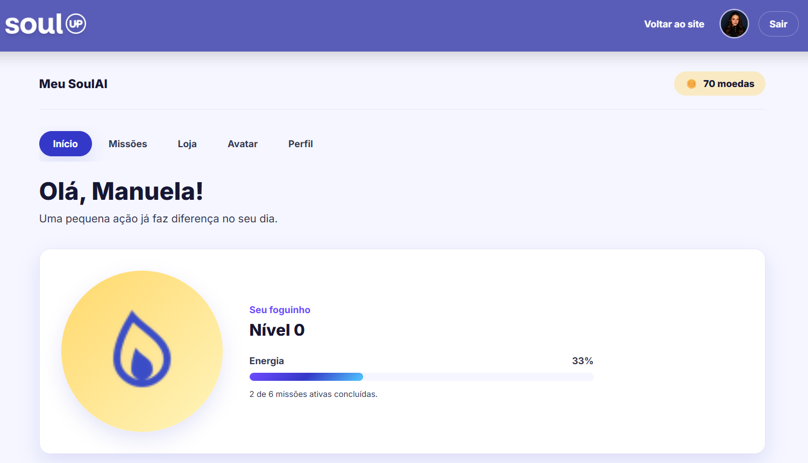
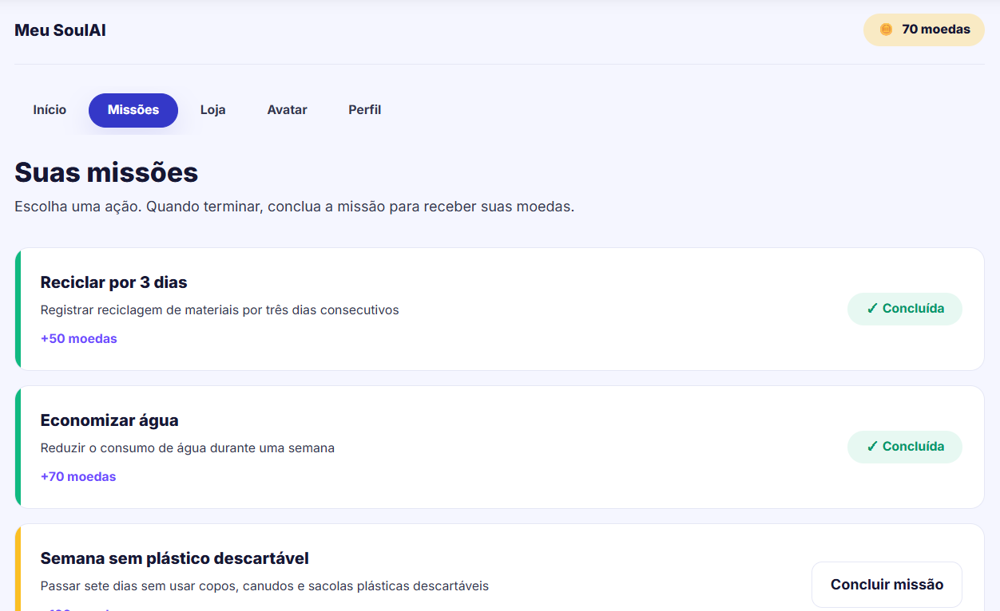
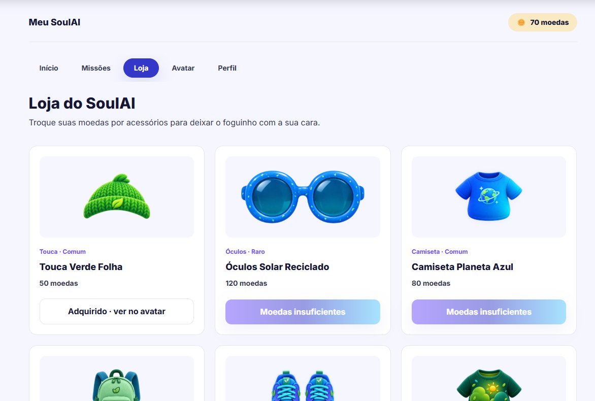
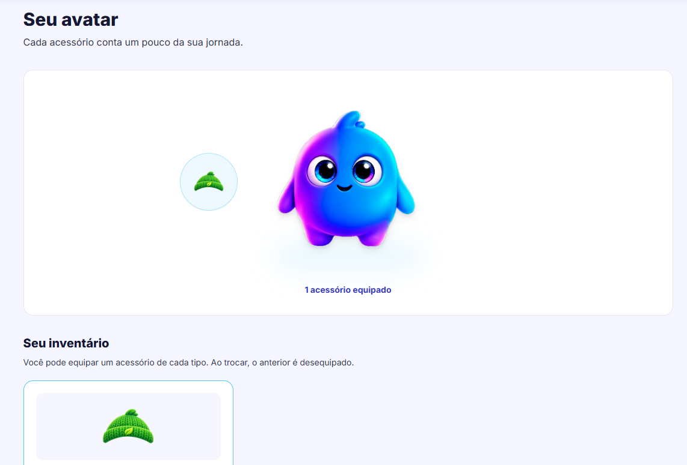
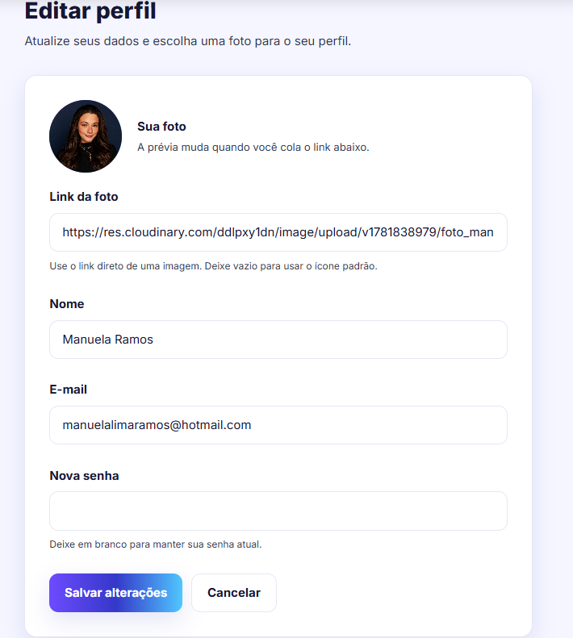
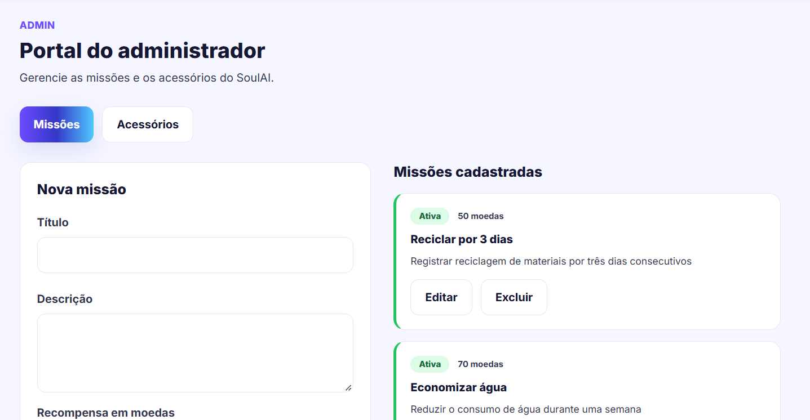
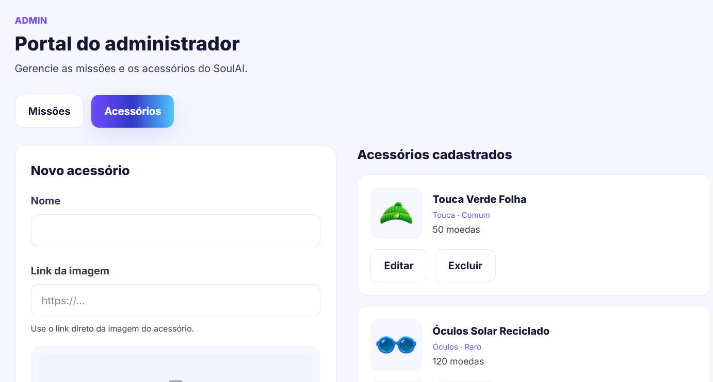
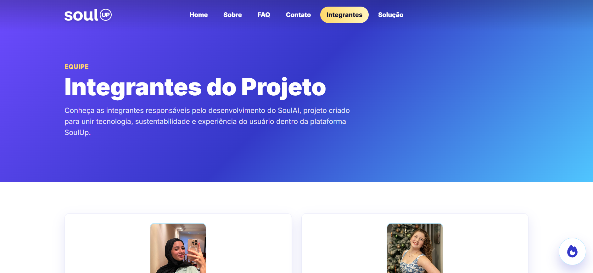

# SoulAI - SoulUp

<p align="center">
  
</p>

<p align="center">
  
</p>

<h3 align="center">
  Avatar inteligente, gamificação e sustentabilidade dentro da experiência SoulUp.
</h3>

<p align="center">
  Projeto acadêmico desenvolvido para o <strong>Challenge FIAP 2026</strong>.
</p>

<p align="center">
  
  
  
  
</p>

<p align="center">
  
  
  
  
</p>

<p align="center">
  <a href="https://soul-ai-projeto.vercel.app/">
    
  </a>
  <a href="https://github.com/manuelalramos/SoulAi_Projeto">
    
  </a>
</p>

---

## Sumário

- [Sobre o projeto](#sobre-o-projeto)
- [Problema identificado](#problema-identificado)
- [Proposta do SoulAI](#proposta-do-soulai)
- [Objetivos](#objetivos)
- [Novidades da Sprint 4](#novidades-da-sprint-4)
- [Evolução do projeto](#evolução-do-projeto)
- [Por que migramos para React](#por-que-migramos-para-react)
- [Tecnologias utilizadas](#tecnologias-utilizadas)
- [Arquitetura atual](#arquitetura-atual)
- [Fluxo de inicialização](#fluxo-de-inicialização)
- [Estrutura de pastas](#estrutura-de-pastas)
- [Responsabilidade das pastas](#responsabilidade-das-pastas)
- [Sistema de rotas](#sistema-de-rotas)
- [Páginas da aplicação](#páginas-da-aplicação)
- [Login, cadastro e área logada](#login-cadastro-e-área-logada)
- [Portal do administrador](#portal-do-administrador)
- [Integração com a API (Java)](#integração-com-a-api-java)
- [Componentes reutilizáveis](#componentes-reutilizáveis)
- [Dados e tipos](#dados-e-tipos)
- [Hooks](#hooks)
- [Gerenciamento de estado](#gerenciamento-de-estado)
- [Responsividade](#responsividade)
- [Acessibilidade](#acessibilidade)
- [Identidade visual](#identidade-visual)
- [Prints do projeto](#prints-do-projeto)
- [Tailwind CSS](#tailwind-css)
- [Qualidade e validações](#qualidade-e-validações)
- [Git Flow e histórico](#git-flow-e-histórico)
- [Padrão de commits](#padrão-de-commits)
- [Como instalar](#como-instalar)
- [Como usar](#como-usar)
- [Scripts disponíveis](#scripts-disponíveis)
- [Deploy](#deploy)
- [Limitações atuais](#limitações-atuais)
- [Possíveis evoluções futuras](#possíveis-evoluções-futuras)
- [Integrantes](#integrantes)
- [Links](#links)
- [Contato](#contato)
- [Resumo das decisões técnicas](#resumo-das-decisões-técnicas)
- [Conclusão](#conclusão)

---

## Sobre o projeto

O **SoulAI** é uma proposta de evolução da experiência digital da plataforma **SoulUp**.

A solução foi criada a partir da ideia de transformar o uso da plataforma em uma experiência mais interativa, personalizada e recorrente por meio de um **avatar inteligente**.

O avatar funciona como um companheiro digital dentro da experiência SoulUp. Ele ajuda o usuário a compreender suas possibilidades dentro da plataforma, acompanhar seu progresso, receber sugestões de ações e visualizar recompensas relacionadas ao seu engajamento.

O projeto combina:

- inteligência artificial como conceito de personalização;
- gamificação;
- missões;
- progresso visual;
- recompensas;
- interação com avatar;
- sustentabilidade;
- experiência do usuário;
- incentivo ao retorno frequente à plataforma.

Na Sprint 4, além da proposta institucional, o site passou a ter uma **área logada funcional** que consome uma **API REST real** (desenvolvida na disciplina de Java), permitindo login, cadastro, missões, loja, avatar e um portal administrativo.

---

## Problema identificado

Aplicações relacionadas a sustentabilidade podem ter dificuldade em manter o usuário interessado por longos períodos.

Mesmo quando uma plataforma oferece benefícios importantes, o usuário pode:

- entrar poucas vezes;
- não saber qual ação realizar em seguida;
- não visualizar claramente seu progresso;
- não perceber recompensas imediatas;
- perder o interesse ao longo do tempo;
- não criar uma rotina de uso.

O SoulAI foi pensado para atuar nesse ponto.

A proposta não substitui a SoulUp. Ela funciona como uma **camada adicional de interação, personalização e gamificação** dentro da experiência já existente.

---

## Proposta do SoulAI

O SoulAI propõe um avatar inteligente capaz de acompanhar a jornada do usuário e transformar ações dentro da plataforma em uma experiência mais clara e recompensadora.

Entre os principais conceitos apresentados estão:

### Avatar inteligente

O avatar atua como um companheiro digital que orienta, incentiva e reconhece o progresso do usuário.

### Missões

O usuário pode receber pequenas sugestões de ações sustentáveis ou atividades relacionadas à plataforma.

### Foguinho progressivo

O progresso não depende apenas de entrar no aplicativo. Cada ação contribui de maneira diferente para o preenchimento do foguinho.

Ações simples possuem peso menor, enquanto ações mais relevantes podem gerar progresso maior.

### Pontos

As interações realizadas pelo usuário podem gerar pontos proporcionais ao nível de esforço e importância da ação.

### Recompensas

Os pontos acumulados podem ser associados a:

- personalização do avatar;
- itens especiais;
- benefícios;
- recompensas;
- apoio relacionado à conta de luz.

### Engajamento

A combinação desses recursos cria novos motivos para o usuário retornar à SoulUp e continuar participando.

---

## Objetivos

O projeto possui como objetivo principal:

> Aumentar o engajamento dos usuários dentro da SoulUp, transformando ações sustentáveis em uma experiência mais interativa, personalizada e recompensadora.

Também fazem parte dos objetivos:

- estimular o retorno frequente à plataforma;
- tornar o progresso mais visível;
- facilitar a compreensão das funcionalidades;
- criar uma experiência mais próxima do público jovem;
- utilizar gamificação sem tornar o uso cansativo;
- conectar tecnologia e sustentabilidade;
- melhorar a experiência do usuário;
- apresentar a proposta em uma aplicação web moderna e responsiva.

---

## Novidades da Sprint 4

A Sprint 4 é a etapa final do projeto e tem como foco a **integração real com o back-end** e a consolidação da aplicação em nível profissional. As principais novidades em relação à Sprint 3 são:

- **Área logada funcional:** além do site institucional, a aplicação agora possui login, cadastro e uma área do usuário com dashboard, missões, loja, avatar e perfil.
- **Integração com a API em Java:** o front-end consome a API REST do grupo (publicada na nuvem) por meio de requisições HTTP, com operações de leitura e de escrita.
- **Portal do administrador:** uma área separada, acessível por login de administrador, com CRUD de missões e acessórios consumindo a API.
- **Consentimento LGPD no cadastro:** tela de consentimento com opções obrigatórias e opcionais.
- **Camada de integração organizada:** todas as chamadas à API ficam centralizadas em `src/data/api.ts`, com as respostas tipadas em TypeScript e tratamento de carregamento e erro.
- **Deploy na Vercel:** a aplicação foi publicada e já consome a API remotamente.
- **Gerenciamento de estado com Context API:** contextos de sessão e de progresso para a área logada.

Essas adições foram feitas **sobre** a base da Sprint 3, preservando a arquitetura modular, a identidade visual e o padrão SPA.

---

## Evolução do projeto

Um dos pontos importantes do projeto foi a migração da aplicação, que anteriormente utilizava **HTML, CSS e JavaScript Vanilla**, para uma arquitetura baseada em **React, TypeScript, Vite e Tailwind CSS** (Sprint 3). Na Sprint 4, essa base evoluiu para uma aplicação integrada a um back-end real.

A versão Vanilla anterior possuía uma estrutura parecida com:

```text
SoulAi_Projeto/
├── index.html
├── pages/
│   ├── sobre.html
│   ├── funcionalidades.html
│   ├── integrantes.html
│   ├── faq.html
│   └── contato.html
├── assets/
│   ├── css/
│   ├── js/
│   └── media/
└── README.md
```

Cada página possuía seu próprio HTML, os estilos estavam distribuídos em arquivos CSS e os comportamentos eram controlados por JavaScript.

A migração para React aconteceu por etapas (Sprint 3):

1. criação do projeto com Vite;
2. configuração do React;
3. adição do TypeScript;
4. configuração do Tailwind CSS;
5. criação da estrutura de pastas;
6. componentização de partes repetidas;
7. configuração do sistema de rotas;
8. migração das páginas;
9. criação de dados e tipos separados;
10. implementação de interações;
11. ajustes de responsividade;
12. melhorias de acessibilidade;
13. remoção dos arquivos legados não utilizados.

E, na Sprint 4, foram acrescentadas a área logada, o portal do administrador, a integração com a API em Java e o deploy na Vercel.

O histórico de commits do repositório mostra essa evolução por branches e Pull Requests.

---

## Por que migramos para React

A migração trouxe uma organização mais adequada para uma aplicação com várias páginas e comportamentos interativos.

No código Vanilla, elementos como Header, Footer, menu, cards e seções precisavam ser repetidos ou tratados manualmente. Com React, essas partes puderam ser transformadas em componentes reutilizáveis.

Exemplos de componentes reutilizáveis criados:

- Header;
- Footer;
- NavMenu;
- PageIntro;
- Carrossel;
- TeamCard;
- FAQItem;
- FloatingChat.

A arquitetura também passou a separar melhor:

- interface;
- dados;
- tipos;
- rotas;
- comportamentos;
- páginas;
- componentes.

Isso facilita:

- manutenção;
- leitura;
- reutilização;
- evolução;
- identificação de responsabilidades;
- trabalho em equipe;
- validação técnica antes da entrega.

---

## Tecnologias utilizadas

### React

Responsável pela construção da interface por componentes.

Foi utilizado para criar:

- páginas;
- componentes reutilizáveis;
- estados;
- interações;
- formulários;
- carrossel;
- FAQ;
- chat;
- navegação;
- área logada e portal administrativo.

### TypeScript

O TypeScript foi utilizado para adicionar tipagem ao projeto.

Em vez de trabalhar com objetos sem estrutura definida, o projeto possui tipos para diferentes domínios.

Exemplos:

- `TeamMember`;
- `SolutionFeature`;
- `ContactFormData`;
- `FaqQuestion`;
- `CardContent`;
- `NavigationItem`;
- `ChatMessage`;
- `Usuario`, `Administrador`, `Missao`, `Acessorio` (tipos usados na integração com a API).

Isso ajuda a evitar erros e deixa explícito quais dados cada componente espera receber.

### Vite

O Vite é utilizado como ferramenta de desenvolvimento e build.

Ele é responsável por:

- iniciar o servidor local;
- processar os módulos;
- integrar React;
- criar o build final;
- gerar a pasta `dist`.

### Tailwind CSS

O Tailwind CSS é responsável pela maior parte da estilização da interface.

A decisão foi evitar recriar vários arquivos CSS externos por página. Por isso, os estilos específicos dos componentes são aplicados principalmente por classes utilitárias.

Exemplo:

```tsx
className="rounded-xl border border-soul-blue/10 bg-white p-6 shadow-card"
```

### React Router DOM

Responsável pela navegação da SPA.

É utilizado para:

- páginas estáticas;
- rota dinâmica;
- rotas aninhadas da área logada;
- navegação sem recarregar toda a aplicação;
- parâmetros de URL;
- navegação programática;
- página 404.

### React Hook Form

Utilizado no formulário de contato e nos formulários de login, cadastro e edição de perfil.

Responsável por:

- registro dos campos;
- submissão;
- validações;
- mensagens de erro;
- reset do formulário.

### Fetch API

Utilizada para o consumo da API em Java, sem bibliotecas externas de requisição (Axios não é utilizado). As chamadas ficam centralizadas na camada de integração.

### Oxlint

Utilizado para análise estática do código através do comando:

```bash
npm run lint
```

### PostCSS e Autoprefixer

Fazem parte da configuração do Tailwind CSS e do processamento do CSS.

### Font Awesome

Utilizado para ícones presentes na aplicação, como menu, e-mail, localização, redes sociais, setas e botão flutuante do chat.

### Google Fonts

Utilizado para carregar a fonte **Inter**, usada como fonte principal da interface.

---

## Principais dependências

O projeto utiliza atualmente as seguintes dependências principais:

```json
{
  "react": "^19.2.8",
  "react-dom": "^19.2.8",
  "react-hook-form": "^7.87.0",
  "react-router-dom": "^7.18.3"
}
```

Entre as principais dependências de desenvolvimento estão TypeScript, Vite, Tailwind CSS, PostCSS, Autoprefixer, Oxlint, `@vitejs/plugin-react`, `@types/react`, `@types/react-dom` e `@types/node`.

---

## Arquitetura atual

A arquitetura foi organizada por responsabilidade.

A aplicação segue este fluxo:

```text
index.html
  -> src/main.tsx
  -> SessaoProvider
  -> RouterProvider
  -> App.tsx
  -> MainLayout
  -> Outlet
  -> Page (site institucional, área logada ou admin)
  -> Sections / Components
  -> Data + Types + API
```

Essa divisão evita concentrar toda a aplicação em um único arquivo e ajuda a separar o que é estrutura, página, componente, conteúdo, tipo e integração.

---

## Fluxo de inicialização

### 1. `index.html`

É o documento HTML inicial carregado pelo navegador.

Ele possui:

```html
<div id="root"></div>
```

Essa `div` funciona como ponto de entrada da aplicação React. Também são carregados metadados básicos, favicon, fonte Inter, Font Awesome e o script principal do Vite.

### 2. `src/main.tsx`

O `main.tsx` inicializa a aplicação. Nele são configurados `StrictMode`, `createRoot`, `createBrowserRouter`, `RouterProvider`, os provedores de contexto (sessão) e a importação do CSS global. O router define as rotas principais e renderiza cada página dentro do layout global.

### 3. `src/App.tsx`

O `App` representa a estrutura principal da aplicação e usa `<Outlet />`, que representa o local onde o React Router renderiza a página correspondente à URL atual.

### 4. `MainLayout`

O `MainLayout` evita repetição entre as páginas, centralizando Header, elemento `main`, chat flutuante e Footer.

---

## Estrutura de pastas

```text
SoulAi_Projeto/
├── .github/
├── public/
│   └── icone.png
├── src/
│   ├── assets/
│   │   └── media/
│   │       ├── avatar-base.png
│   │       ├── avatar_hero.mp4
│   │       ├── fogo.png
│   │       ├── icone.png
│   │       ├── logo-soulup.png
│   │       ├── foto_lena.jpeg
│   │       ├── foto_lyvia.jpeg
│   │       ├── foto_manuela.jpg
│   │       └── foto_yasmin.jpeg
│   ├── components/
│   │   ├── Carrossel/
│   │   ├── FAQItem/
│   │   ├── FloatingChat/
│   │   ├── Footer/
│   │   ├── Header/
│   │   ├── NavMenu/
│   │   ├── PageIntro/
│   │   ├── TeamCard/
│   │   └── ... (componentes da área logada)
│   ├── contexts/        # contextos de sessão e progresso (Sprint 4)
│   ├── data/
│   │   ├── about.ts
│   │   ├── api.ts       # camada de integração com a API Java (Sprint 4)
│   │   ├── chat.ts
│   │   ├── faq.ts
│   │   ├── home.ts
│   │   ├── navigation.ts
│   │   ├── solution.ts
│   │   └── team.ts
│   ├── hooks/           # useScrollToTop, useSessao, useProgresso
│   ├── layouts/         # MainLayout e layouts da área logada
│   ├── pages/
│   │   ├── Home/
│   │   ├── Sobre/
│   │   ├── Integrantes/
│   │   ├── FAQ/
│   │   ├── Contato/
│   │   ├── Solucao/
│   │   ├── Login/       # Sprint 4
│   │   ├── Cadastro/    # Sprint 4
│   │   ├── Dashboard/   # Sprint 4
│   │   ├── Missoes/     # Sprint 4
│   │   ├── Loja/        # Sprint 4
│   │   ├── Avatar/      # Sprint 4
│   │   ├── Perfil/      # Sprint 4
│   │   ├── EditarPerfil/# Sprint 4
│   │   ├── Admin/       # Sprint 4
│   │   └── NotFound/
│   ├── routes/
│   ├── types/
│   ├── App.tsx
│   ├── index.css
│   └── main.tsx
├── .gitignore
├── .oxlintrc.json
├── index.html
├── package-lock.json
├── package.json
├── postcss.config.cjs
├── README.md
├── tailwind.config.cjs
├── tsconfig.app.json
├── tsconfig.json
├── tsconfig.node.json
└── vite.config.ts
```

Observação: `node_modules/` e `dist/` são pastas geradas localmente e não precisam ser versionadas no repositório.

---

## Responsabilidade das pastas

### `public`
Guarda arquivos estáticos servidos diretamente pelo Vite (como o favicon).

### `src/assets/media`
Guarda imagens e vídeos usados pela interface: logo da SoulUp, ícone, vídeo do avatar na hero, imagem do foguinho, avatar base e fotos das integrantes.

### `src/components`
Guarda componentes reutilizáveis. Não representam páginas completas; são blocos menores usados em várias partes da aplicação.

### `src/contexts`
Guarda os contextos da área logada (Sprint 4): a **sessão** (usuário ou administrador logado) e o **progresso** (dados do usuário vindos da API).

### `src/data`
Centraliza conteúdos estáticos (FAQ, integrantes, navegação, mensagens do chat, funcionalidades da solução, textos e cards) e a **camada de integração com a API** (`api.ts`).

### `src/hooks`
Guarda hooks próprios: `useScrollToTop`, além de `useSessao` e `useProgresso` (Sprint 4).

### `src/layouts`
Guarda estruturas compartilhadas entre páginas (o `MainLayout` e os layouts da área logada e de acesso).

### `src/pages`
Guarda a implementação visual de cada página. Algumas páginas possuem uma pasta `sections` para separar blocos internos.

### `src/routes`
Guarda arquivos de entrada para as rotas, separando o roteamento da implementação das páginas.

### `src/types`
Guarda tipos TypeScript compartilhados, definindo os formatos esperados para os dados usados no projeto, incluindo os dados recebidos da API.

---

## Sistema de rotas

As rotas são configuradas em `src/main.tsx` com `createBrowserRouter`.

| Rota | Página renderizada | Observação |
|---|---|---|
| `/` | Home | Página inicial |
| `/sobre` | Sobre | Explica a proposta e os objetivos |
| `/integrantes` | Integrantes | Mostra a equipe |
| `/faq` | FAQ | Perguntas frequentes |
| `/contato` | Contato | Formulário validado |
| `/solucao` | Solução | Fluxo e funcionalidades |
| `/solucao/:slug` | Solução Detalhe | **Rota dinâmica** (parâmetro na URL) |
| `/login` | Login | Acesso de usuário e de administrador |
| `/cadastro` | Cadastro | Cria conta + consentimento LGPD |
| `/app` | Dashboard | Área logada (protegida) |
| `/app/missoes` | Missões | Área logada |
| `/app/loja` | Loja | Área logada |
| `/app/avatar` | Avatar | Área logada |
| `/app/perfil` | Perfil | Área logada |
| `/app/perfil/editar` | Editar Perfil | Área logada |
| `/admin` | Portal do Administrador | CRUD via API |
| `*` | NotFound | Página para rota inexistente |

### Rota dinâmica da solução

A rota `/solucao/:slug` permite abrir detalhes de uma funcionalidade sem criar uma página manual para cada item. Os slugs vêm de `src/data/solution.ts` (`missoes`, `foguinho`, `pontos`, `avatar`). Se o usuário acessar um slug inexistente, a aplicação mostra uma mensagem de recurso não encontrado e oferece botão de retorno.

---

## Páginas da aplicação

### Site institucional
Home, Sobre, Solução (com rota dinâmica), FAQ, Integrantes, Contato e NotFound — como descrito nas seções seguintes.

### Home
Seções: `HeroSection`, `HomeAboutSection`, `HomeExperienceSection`. Apresenta o SoulAI com um hero em vídeo, uma explicação inicial e um carrossel com pontos da experiência.

### Sobre
Seções: `AboutObjectiveSection`, `AboutHighlightsSection`, `FireProgressSection`, `RoadmapSection`. Explica a relação entre SoulUp e SoulAI, objetivos, diferenciais e caminhos futuros.

### Solução
`Solucao.tsx` e `SolucaoDetalhe.tsx`, com `FlowSection`, `FeatureShowcaseSection` e `SolutionDetailContent`. Mostra como o SoulAI funciona e as funcionalidades.

### FAQ
Usa o componente `FAQItem` para exibir perguntas e respostas interativas.

### Integrantes
Usa `TeamCard` para exibir nome, RM, turma, foto, GitHub e LinkedIn.

### Contato
Formulário com validações usando React Hook Form, modal de sucesso e redirecionamento automático para a Home.

### NotFound
Renderiza uma página de erro quando o usuário acessa uma rota inexistente.

---

## Login, cadastro e área logada

Na Sprint 4, a aplicação ganhou uma área funcional, acessível após autenticação:

### Login
A tela de login (`/login`) permite entrar como **usuário** ou como **administrador**, com uma opção discreta de acesso restrito. As credenciais são validadas pela API em Java; em caso de erro, é exibida uma mensagem amigável.

### Cadastro
A tela de cadastro (`/cadastro`) cria uma conta nova (que nasce zerada) e inclui um bloco de **consentimento LGPD**, com uma opção obrigatória e opções opcionais.

### Área logada (`/app`)
Depois do login, o usuário acessa:

- **Dashboard:** saudação, foguinho/ofensiva, saldo de moedas e missões do dia;
- **Missões:** lista de missões, com conclusão e recompensa;
- **Loja:** acessórios com preço, para comprar com moedas;
- **Avatar:** avatar com os itens equipados;
- **Perfil / Editar Perfil:** dados do usuário, com edição de nome, e-mail, senha e foto.

A sessão é mantida em memória por meio de Context API, e há um botão para voltar ao site institucional sem perder o login.

---

## Portal do administrador

O portal do administrador (`/admin`) é acessível por um login específico de administrador e é separado da área do usuário comum.

Nele é possível:

- gerenciar **missões** (listar, criar, editar e excluir);
- gerenciar **acessórios** (listar, criar, editar e excluir);
- visualizar o status de cada item (ativo/inativo).

Todas essas operações consomem a API em Java, demonstrando as operações de escrita (POST, PUT e DELETE) exigidas na integração.

---

## Integração com a API (Java)

A integração com o back-end é o foco técnico da Sprint 4.

### Camada de integração

Todas as chamadas HTTP ficam centralizadas em **`src/data/api.ts`**, evitando requisições espalhadas pelos componentes. A URL base da API fica em uma constante:

```ts
export const API_BASE = "https://soulai-api.onrender.com";
```

### Operações consumidas

- **Leitura (GET):** login, listagem de missões, loja/acessórios, inventário e avatar;
- **Escrita (POST / PUT / DELETE):** cadastro de usuário, conclusão de missão, compra e troca de acessório, edição de perfil, e o CRUD de missões e acessórios no portal do administrador.

### Tipagem, carregamento e erro

As respostas da API são **tipadas com TypeScript**, e a aplicação trata estados de **carregamento**, **erro** e **resposta vazia**, exibindo mensagens adequadas ao usuário. Por estar hospedada em um serviço gratuito, a primeira requisição à API pode levar alguns segundos enquanto o serviço é reativado.

---

## Componentes reutilizáveis

### Header
Exibe a logo, abre/fecha o menu mobile, muda o visual após o scroll e fecha o menu ao trocar de rota. Na área logada, também mostra o acesso ao perfil.

### NavMenu
Renderiza os links definidos em `src/data/navigation.ts`, usando `NavLink` para destacar a página ativa.

### Footer
Exibe informações do projeto, links de navegação e dados de contato.

### FloatingChat
Representa uma demonstração visual da interação com o SoulAI, com botão flutuante, abertura/fechamento, mensagens aparecendo aos poucos e indicador de digitação. O chat é demonstrativo e usa dados locais de `src/data/chat.ts`.

### Carrossel
Componente reutilizável para apresentar cards em sequência, com botões, indicadores, loop e adaptação para diferentes telas.

### PageIntro
Usado no topo de páginas internas para manter o padrão visual.

### FAQItem
Renderiza uma pergunta do FAQ com controle de abertura e fechamento.

### TeamCard
Renderiza os dados de cada integrante.

> Além desses, a Sprint 4 acrescentou componentes da área logada (cards de missão, imagem de acessório, foto de perfil, componente de carregamento, entre outros).

---

## Dados e tipos

### Pasta `data`

| Arquivo | Responsabilidade |
|---|---|
| `about.ts` | conteúdo da página Sobre |
| `api.ts` | camada de integração com a API Java |
| `chat.ts` | mensagens da demonstração do chat |
| `faq.ts` | perguntas e respostas do FAQ |
| `home.ts` | cards da Home |
| `navigation.ts` | links do menu |
| `solution.ts` | funcionalidades, fluxo e detalhes da solução |
| `team.ts` | dados das integrantes |

### Pasta `types`

| Arquivo | Tipo principal |
|---|---|
| `card.ts` | `CardContent` |
| `chat.ts` | `ChatMessage` |
| `faq.ts` | `FaqQuestion` |
| `form.ts` | `ContactFormData` |
| `navigation.ts` | `NavigationItem` |
| `solution.ts` | `SolutionFeature` |
| `team.ts` | `TeamMember` |

> Os tipos usados na integração com a API (usuário, administrador, missão, acessório) também são definidos em TypeScript, garantindo segurança no consumo dos dados.

---

## Hooks

### `useScrollToTop`
Observa a mudança de rota com `useLocation` e leva o usuário ao topo quando a rota muda.

### `useSessao` e `useProgresso` (Sprint 4)
Fornecem acesso ao contexto de sessão (quem está logado) e ao progresso do usuário (dados vindos da API), usados pelas páginas da área logada.

---

## Gerenciamento de estado

O projeto utiliza estados locais com hooks do React (`useState`, `useEffect`, `useRef`) para o menu mobile, o carrossel, o chat flutuante e o formulário de contato.

Na Sprint 4, para a área logada, foi adicionada a **Context API**, com contextos de **sessão** e de **progresso**, mantendo em memória os dados do usuário autenticado e evitando repassar propriedades por muitos níveis.

---

## Responsividade

O projeto foi estruturado para funcionar em diferentes tamanhos de tela (desktop, notebook, tablet e celular), usando classes responsivas do Tailwind, grids adaptáveis, menu mobile, carrossel reorganizado, `max-width` para telas grandes e prevenção de scroll horizontal.

Checklist recomendado:

```text
375px
425px
768px
992px
1440px
```

Conferir nessas larguras: Header, menu mobile, hero, botões, cards, carrossel, FAQ, formulário, integrantes, solução, área logada e footer.

---

## Acessibilidade

O projeto utiliza recursos de acessibilidade em diferentes pontos: `aria-label` em botões e links, `aria-expanded` no menu e no chat, `aria-hidden` em ícones decorativos, `alt` em imagens relevantes, `label` associado aos campos do formulário, mensagens de erro próximas aos campos e HTML semântico (`header`, `main`, `section`, `article`, `aside`, `footer`, `nav`).

---

## Identidade visual

Cores principais configuradas no Tailwind:

| Token | Cor |
|---|---|
| `soul.purple` | `#6e4bff` |
| `soul.blue` | `#3438c8` |
| `soul.cyan` | `#50c7ff` |
| `soul.yellow` | `#ffd86b` |
| `soul.ink` | `#161733` |
| `soul.text` | `#33364f` |
| `soul.soft` | `#f5f6ff` |
| `soul.line` | `#e5e7f5` |

Foco visual: leitura clara, visual jovem, sensação tecnológica, contraste em botões e áreas importantes, uso de vídeos e imagens locais e consistência entre páginas.

---

## Prints do projeto

> Coloque os prints na pasta `docs/prints/` do repositório com os nomes abaixo.

<p align="center">
  
</p>

<p align="center">
  
</p>

<p align="center">
  
</p>

<p align="center">
  
</p>

<p align="center">
  
</p>

<p align="center">
  
</p>

<p align="center">
  
</p>

<p align="center">
  
</p>

<p align="center">
  
</p>

<p align="center">
  
</p>

<p align="center">
  
</p>

<p align="center">
  
</p>

<p align="center">
  
</p>

---

## Tailwind CSS

O Tailwind está configurado em `tailwind.config.cjs`, que centraliza cores personalizadas, gradiente principal, sombras, animações e keyframes. O CSS global fica em `src/index.css`, com as diretivas do Tailwind, scroll suave, base do `body`, fonte padrão e ajustes globais para imagens, vídeos, links, botões e campos.

---

## Qualidade e validações

### Lint
```bash
npm run lint
```
Executa o Oxlint para análise estática.

### Build
```bash
npm run build
```
Executa `tsc -b` e `vite build`, verificando TypeScript e gerando a versão de produção em `dist`.

### Preview
```bash
npm run preview
```
Permite visualizar localmente a versão gerada pelo build.

---

## Git Flow e histórico

O desenvolvimento foi organizado com branches de feature e Pull Requests, seguindo o **Git Flow**. Cada parte importante foi separada em uma branch própria, permitindo trabalhar em funcionalidades específicas sem misturar alterações. O histórico de branches e PRs no GitHub registra a evolução do projeto desde a configuração inicial em React até a integração com a API e o deploy.

---

## Padrão de commits

O histórico utiliza mensagens curtas indicando o tipo da mudança:

```text
feat : cria tela de login de usuario e admin
feat : adiciona integracao com a api de missoes
feat : cria portal do administrador
fix  : corrige mensagem de erro do login
style: ajusta responsividade do dashboard
chore: configura deploy na vercel
```

Tipos comuns: `feat` (nova funcionalidade), `fix` (correção), `refactor` (reorganização), `style` (ajustes visuais) e `chore` (configuração ou manutenção).

---

## Como instalar

### Pré-requisitos
Node.js, npm e Git.

### 1. Clonar o repositório
```bash
git clone https://github.com/manuelalramos/SoulAi_Projeto.git
```

### 2. Entrar na pasta
```bash
cd SoulAi_Projeto
```

### 3. Instalar dependências
```bash
npm install
```

---

## Como usar

### Links do projeto

| Recurso | Link |
|---------|------|
| Repositório (GitHub) | https://github.com/manuelalramos/SoulAi_Projeto |
| Deploy (Vercel) | https://soul-ai-projeto.vercel.app/ |
| API (Java) | https://soulai-api.onrender.com |
| Vídeo (YouTube) | https://youtu.be/ZZCQs90v0tY |

A aplicação publicada na Vercel já consome remotamente a API em Java, permitindo os testes online.

### Executar localmente

```bash
npm run dev
```

O Vite mostrará um endereço como `http://localhost:5173/`. A URL da API já vem configurada em `src/data/api.ts`.

---

## Scripts disponíveis

| Script | Comando | Descrição |
|---|---|---|
| `dev` | `npm run dev` | inicia o servidor Vite |
| `build` | `npm run build` | executa TypeScript e gera build de produção |
| `preview` | `npm run preview` | visualiza localmente o build |
| `lint` | `npm run lint` | executa análise estática com Oxlint |

---

## Deploy

A aplicação está publicada na **Vercel**:

```text
https://soul-ai-projeto.vercel.app/
```

A Vercel está conectada ao repositório do GitHub, então cada atualização na branch de produção gera um novo deploy automaticamente. A aplicação publicada consome a API em Java hospedada na nuvem.

---

## Limitações atuais

### Chat
O `FloatingChat` representa uma demonstração da experiência do SoulAI e não está conectado a um modelo de IA (está previsto como evolução futura).

### Portal do administrador
Nesta versão, o acesso de administrador é diferenciado pelo login; o controle de permissões é simplificado para o escopo acadêmico.

### Benefício na conta de luz
O cálculo de desconto é uma simulação, sem aplicação em uma conta real.

### Persistência local
Alguns dados de apoio continuam locais; a persistência principal é feita pela API e pelo banco de dados do projeto.

---

## Possíveis evoluções futuras

- integração real com inteligência artificial no chat;
- controle de permissões mais completo no portal admin;
- histórico do usuário;
- notificações;
- testes automatizados;
- melhorias adicionais de acessibilidade.

---

## Integrantes

<table>
  <tr>
    <td align="center">
      <br />
      <strong>Lena Haidar Halawi</strong><br />
      RM 572258<br />
      1TDSPF<br /><br />
      <a href="https://github.com/Lenahalawi07">GitHub</a><br />
      <a href="https://www.linkedin.com/in/lena-haidar-halawi-09134a3b8">LinkedIn</a>
    </td>
    <td align="center">
      <br />
      <strong>Lyvia Correa de Amorim</strong><br />
      RM 569851<br />
      1TDSPF<br /><br />
      <a href="https://github.com/lyviaamorim">GitHub</a><br />
      <a href="https://www.linkedin.com/in/lyvia-correa-de-amorim-0203493b8/">LinkedIn</a>
    </td>
    <td align="center">
      <br />
      <strong>Manuela de Lima Ramos</strong><br />
      RM 572956<br />
      1TDSPF<br /><br />
      <a href="https://github.com/manuelalramos">GitHub</a><br />
      <a href="https://www.linkedin.com/in/manuelalramos">LinkedIn</a>
    </td>
    <td align="center">
      <br />
      <strong>Yasmin Souza Silva Martins</strong><br />
      RM 572102<br />
      1TDSPF<br /><br />
      <a href="https://github.com/yasminmartins18">GitHub</a><br />
      <a href="https://www.linkedin.com/in/yasmin-souza-silva-martins-32085b376">LinkedIn</a>
    </td>
  </tr>
</table>

---

## Links

### Repositório
```text
https://github.com/manuelalramos/SoulAi_Projeto
```

### Aplicação (Vercel)
```text
https://soul-ai-projeto.vercel.app/
```

### API (Java)
```text
https://soulai-api.onrender.com
```

### Vídeo (YouTube)
```text
https://youtu.be/ZZCQs90v0tY
```

---

## Contato

Na interface do projeto é utilizado o endereço demonstrativo:

```text
contato@soulai.com
```

Para informações relacionadas ao desenvolvimento acadêmico, também podem ser utilizados os perfis GitHub e LinkedIn das integrantes, listados na seção Integrantes, ou a página de Contato da aplicação.

---

## Resumo das decisões técnicas

| Decisão | Motivo |
|---|---|
| Migrar de Vanilla para React | Melhorar componentização e organização |
| Utilizar TypeScript | Criar tipos para dados, props, formulários e respostas da API |
| Utilizar Tailwind CSS | Centralizar grande parte da interface nos componentes |
| Criar `data` e `types` | Separar conteúdo e definir contratos de dados |
| Criar `pages` e `routes` | Organizar implementação por tela e separar o roteamento |
| Usar `createBrowserRouter` e `Outlet` | Configurar a SPA com layout compartilhado |
| Criar `MainLayout` | Compartilhar Header, main, chat e Footer |
| Criar rota dinâmica | Evitar uma página manual por funcionalidade |
| Centralizar a API em `data/api.ts` | Organizar o consumo e evitar chamadas espalhadas |
| Usar Context API (Sprint 4) | Gerenciar sessão e progresso da área logada |
| Fazer deploy na Vercel | Disponibilizar a aplicação online consumindo a API |
| Usar Git Flow | Organizar o desenvolvimento por features |

---

## O que esta Sprint demonstra

- React, componentização, props, `useState`, `useEffect`, `useRef`, `useContext`, `useParams`, `useNavigate`;
- React Router, rotas estáticas, rotas dinâmicas, rotas aninhadas e SPA;
- React Hook Form;
- TypeScript, interfaces e types, incluindo a tipagem das respostas da API;
- consumo de API REST com GET, POST, PUT e DELETE;
- camada de integração organizada e tratamento de loading/erro;
- Tailwind CSS, responsividade e acessibilidade;
- Git, GitHub, Git Flow e Pull Requests;
- deploy na Vercel.

---

## Conclusão

O SoulAI evoluiu de um conjunto de páginas HTML independentes para uma **Single Page Application estruturada em React** e, nesta Sprint 4, para uma **aplicação integrada a um back-end real**.

A versão atual possui componentes reutilizáveis, páginas organizadas, dados e tipos separados, rotas estáticas e dinâmica, área logada, portal administrativo, integração com a API em Java, responsividade, acessibilidade, deploy na Vercel e histórico de desenvolvimento por features.

Além de apresentar a proposta do SoulAI, o projeto registra a evolução técnica da equipe ao longo das Sprints, culminando em uma solução web completa, integrada e publicada.

---

<p align="center">
  <strong>SoulAI - tecnologia para tornar ações sustentáveis mais próximas, interativas e recorrentes.</strong>
</p>

<p align="center">
  Challenge FIAP 2026
</p>

<p align="center">
  
</p>